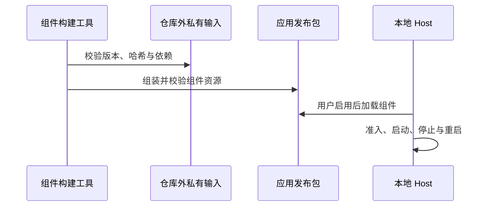

# 内置 Computer Use 组件

## 产品规则

- Computer Use 由公开接口、组件桥接代码和私有运行时组成。私有运行时包含非开源 JavaScript 与原生二进制，不进入公开源码仓库。
- 发布包包含 SDK、技能、helper 及运行依赖，安装后直接使用。组件只随整个应用更新，没有独立下载或升级入口。
- 默认关闭，保留设置中的手动开启入口和系统权限授权。关闭后不得发现、加载或调用；正常模型请求沿用用户配置的 API 端点。
- 内置 `computer-use` 的 canonical id 固定使用随包 SDK/技能；市场发现、单项或批量更新及用户安装记录不能替换它。用户市场的其他同名插件按原有规则处理。
- 组件仅接入桌面本地 Host，不为远程工作区、SSH、WSL、容器或手机创建额外的桌面控制进程。

## 组成与所有者

| 部分     | 位置与职责                                                              |
| -------- | ----------------------------------------------------------------------- |
| 公共接口 | `packages/zcode-cua`：类型、能力声明及运行时加载入口                    |
| 组件桥接 | `scripts/cua-runtime-adapter`：公共导出、broker、帧契约及 Host 生命周期 |
| 私有输入 | 仓库外目录：固定版本的运行时、helper 和原生依赖                         |
| 组件构建 | `scripts/bundled-cua.mjs`：校验输入、适配接口并生成组件包及来源清单     |
| 发布资源 | `resources/tools/zcode-cua` 与 `resources/tools/cua-helper`             |

本地 Host 唯一持有原生进程和 admission transport（socket/authority）。Windows 使用 `WindowsCuaHelperHost`，macOS 使用组件桥接中的 `createProductCuaHelperHost`。Agent spawn 只 acquire Host；启用 CUA 后的 MCP 准备阶段才启动 helper。SDK factory 捕获 authority，使 plugin host 清理环境变量后仍可认证。停止排空原进程后才允许重启。



## 版本与构建

当前组件目标为 Windows x64 和 macOS arm64，应用 3.18.0、CUA 0.6.5、Electron 44.7.0。版本、来源归档与输入哈希集中在 `CUA_RELEASE`；构建清单记录实际输入和输出哈希。归档中的 CUA 段边界及公共导出必须与当前接口匹配，升级应用时一并验证。

构建只选取 CUA 及其运行依赖。Windows 归档按内嵌 7z 载荷提取，不依赖解包工具对 EXE 的自动识别。组件中的 helper 下载入口不可用，缺少随包资源时明确报错。helper 的 broker authenticate 要求 Host 签发的 authority，缺失或错误凭据必须拒绝。资源准备和 afterPack 复用同一组版本、架构、路径与哈希校验。

构建机预装项目要求的 Node/pnpm 和解包工具，输入与输出目录位于公开工作区之外：

```powershell
node scripts/bundled-cua.mjs --target win32-x64 --archive D:/private/cua/ZCode-3.18.0-win-x64.exe --output D:/private/cua/3.18.0-win32-x64 --7zip 7z
$env:ZCODE_CUA_BUNDLE_DIR = 'D:/private/cua/3.18.0-win32-x64'
pnpm bundle:desktop -- --os win --arch x64
pnpm exec tsx scripts/test/bundled-cua-windows-smoke.mts D:/private/release/win-unpacked/resources
```

构建变量仅供构建机选择组件，最终用户无需设置。

GitHub Actions 在 `main` 推送及手动触发时构建两个平台，版本和官方归档路径从 `CUA_RELEASE` 读取。私有组件在 runner 临时目录生成，最终只上传 Windows 解压即用 ZIP、Mac `.app` ZIP 和构建元数据；不生成安装器或 DMG。构建显式关闭遥测端点和官方更新。上传前须验证最终包的原生组件、版本与实际构建提交，并记录 ZIP 的 SHA-256。两端均成功后才发布 Release，Release 标签保留实际构建提交。

## macOS 组件接入

- arm64 组件从同版本 Mac 归档取得。构建只修改固定哈希 helper 的 SEA JavaScript 段，保持 Mach-O 布局和源码字节长度，之后在 macOS 重新签名并严格验签。
- helper 保留同 UID 原生 peer 检查，以 Host authority 验证工具与 presentation 连接。自构建应用不要求官方团队签名；签名适配只影响此组件，不把整个 SDK 切换成开发模式，也不修改 TCC。
- Host 经 LaunchServices 启动随包 `.app`，为本次启动注入 authority；SDK、health、PiP 使用同一份凭据。权限仍归 helper 的系统授权主体；关闭 CUA 后不加载和调用。
- Host 串行管理启动、停止与重启，停止只处理本 Host 的 PID，不按进程名称批量清理。终止未完成时拒绝新启动。
- macOS runner 验证实际签名、helper 启动、错误凭据拒绝、权限状态、停止和重启；授权后的 UI 验收与静态构建分别记录。

## 维护与验证

- 输入版本、哈希、导出或依赖闭包不匹配时终止构建；失败不能损坏已有有效产物。
- 组件生成检查覆盖全部公共导出、Host authority 和禁止运行时下载的行为。
- Windows 发布验收使用最终包，验证 addon 加载、认证、health、观察、截图、专用窗口输入读回、停止及重启。
- 根 `pnpm typecheck`、`pnpm lint` 及相关 CUA/工程测试是代码门禁；设备验收结果随对应 Release 记录。

版本升级步骤见 [组件升级方法](../docs/cua/component-maintenance.md)。构建资源规则见 [组件检测与暂存](../docs/desktop/computer-use-producer-detection.md)，运行时契约见 [Windows 运行时](../docs/cua/windows-product-runtime.md)。
