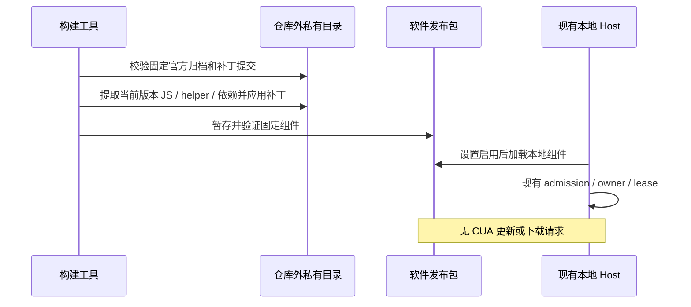

# 随软件发布的 Computer Use

## 产品规则

- CUA 是应用的固定组件；不提供独立检查更新、下载、补丁或自动替换入口。
- 固定范围包含官方 `computer-use` 的 SDK/技能包。官方市场 CDN 不能覆盖随包条目；单独更新该 canonical id 明确拒绝，批量更新跳过，发现时不加载用户安装记录中的替代版本。其他市场的同名插件不受影响。
- 构建者取得固定版本的官方发行包，验证哈希，提取 CUA runtime/helper，应用有版本约束的补丁后打包。用户仅更新整个应用。
- 非开源 JS、原生组件、原始发行包和提取目录全部留在公开工作区之外；仓库只保留清单、适配和构建工具。
- 仅取 Computer Use 的依赖闭包，不导入其他官方联网插件、登录、市场或遥测实现。
- 保留 CUA 设置开关和正常系统权限授权；关闭时不得发现或调用 CUA。模型 API 的正常传输继续沿用现有配置。

## 所有者及流程



构建工具是私有输入和来源清单的唯一所有者；资源 preparer/afterPack 沿用现有校验。WindowsCuaHelperHost 持有 Windows 原生进程。CUA runtime 持有 session/观察/输入状态，不新增平行后台服务或全局环境变量。

本地 Host factory 为随包后端铸造一份不可变的 admission transport（socket/authority），Agent spawn、helper 和 health 共用它。spawn 只 acquire Host 对象，不启动原生进程；MCP 准备在确认 CUA 设置启用、主会话、本地身份后启动该 Host。延续既有稳定 pipe；重启复用此 Host 的 transport，stop 排空原进程后才允许重新启动。runtime factory 捕获凭据，plugin host 清理 env 后 RPC 仍可认证。

## 固定版本及补丁

当前目标为 ZCode 3.17.2、CUA 0.6.5、Electron 44.7.0、Windows x64。补丁项目固定到 luxi233/ZcodePro 的 c81950cb6dbdb4e1529879174632b3909cca26f8；只复用其公开桥接层，不复用旧 vendor runtime 或旧 native helper。

官方 node-repl-host bundle 中的 CUA 分发段作为当前 JS 实现；明确的段边界和未修改输入哈希必须匹配后才提取。补丁去除 helper 下载分支；缺少随包组件时明确失败，不能转到 CDN 或已有其他版本。

官方 0.6.5 Windows helper 的 `WINDOWS_PEER_IDENTITY_GATE_TEMPORARILY_OPEN=true` 使连接方校验失效。本 fork 在 broker authenticate 阶段要求现有 WindowsCuaHelperHost 铸造的 pluginAuthority；helper 子进程和已准入 MCP 复用同一 authority，health 显式携带它。缺失/错误 authority 必须拒绝，原生校验暂缺不能变成任意本地进程可控制桌面。token 不落盘、不在日志输出；不新增密钥存储或后台服务。

## 验收

- 错误归档、版本或补丁提交不得生成可用组件；私有输出必须在 Git 工作区外。
- 提取当前官方 runtime，动态模块闭包可以加载；运行时 helper 下载入口明确失败且网络请求数为零。
- Windows：在目标 Electron 下加载 addon，启动、认证、health、观察、截图、对专用测试窗口输入、停止及重启；禁止用 mock 或改写 manifest 的方式代替。
- 发布包已含全部资源，无环境变量、安装后补丁或首次下载要求。根 typecheck、lint、相关 CUA/工程测试必须报告实际结果。

资源暂存沿用 v1 helper manifest：验证 package/version、平台架构、Electron、相对 entry/addon 路径、SHA-256、PE machine 和自包含 Express/Sharp 依赖闭包。JS 运行时只接收位于包内的公共导出与 Node/相对静态依赖。输入全部验证后再原子替换输出；错误输入不得损坏已有有效产物。afterPack 再验证最终资源。

## 构建与检查入口

构建机预装固定 Node/pnpm 和解包工具，补丁仓库放在公开 checkout 外。Windows 例：

```powershell
node scripts/bundled-cua.mjs --target win32-x64 --archive D:/private/cua/ZCode-3.17.2-win-x64.exe --patch-root D:/private/ZcodePro --output D:/private/cua/3.17.2-win32-x64 --7zip 7z
$env:ZCODE_CUA_BUNDLE_DIR = 'D:/private/cua/3.17.2-win32-x64'
pnpm bundle:desktop -- --os win --arch x64
pnpm exec tsx scripts/test/bundled-cua-windows-smoke.mts D:/private/release/win-unpacked/resources
```

Mac 适配按用户要求暂缓，当前构建入口只接受 Windows x64。
