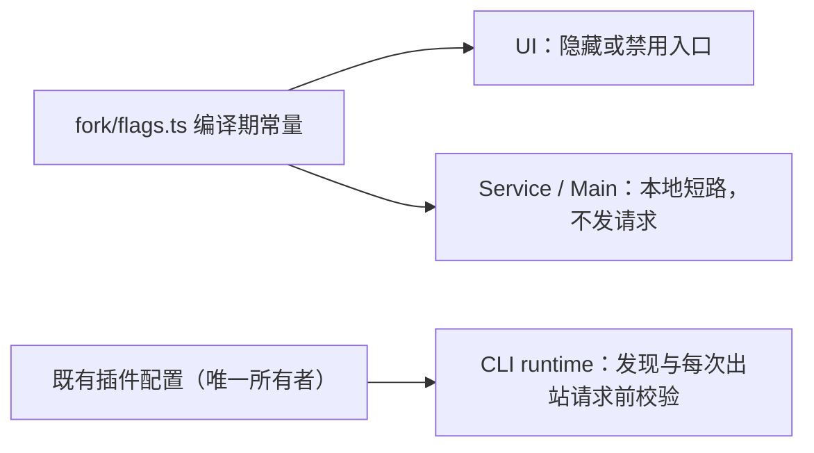

# 修改版隐私与官方入口开关

修改版（fork）关闭若干官方商业/联网入口。所有开关集中在 `packages/shared/src/fork/flags.ts`，均为编译期常量，不新增环境变量、设置项或持久化状态；上游实现保留，仅在调用点短路，恢复只改常量。

## 规则

| 能力 | 开关 / 所有者 | 关闭后的行为 |
|---|---|---|
| 智谱 / Z.ai 官方套餐 | `ZHIPU_OFFICIAL_PLANS_ENABLED` | Coding Plan 模板不可创建；首次配置的套餐 Key 输入、保存与购买入口禁用并说明原因；已有套餐详情不显示可填写表单。按 `access.type` 判断，不按名称或域名猜测；普通 Z.ai/BigModel API、其他供应商与自定义渠道不受影响；不删除已有配置与凭据 |
| 营销触达 | `ZCODE_MARKETING_TOUCH_ENABLED` | Provider 只透传子内容，不建 controller、轮询与素材加载；服务 `query` 返回空快照、`report` 直接完成，不读身份、不发 `/api/v1/marketing/touch*` 请求 |
| 官方应用更新 | `ZCODE_APP_UPDATES_ENABLED` | Main 更新器保持唯一所有者并返回 `idle / enabled: false`；启动、定时、手动、渠道刷新与强制检查均不发请求；菜单、托盘、更新按钮与相关设置隐藏。插件更新不受影响。修改版自身的绿色版更新见 [fork-portable-dist.md](fork-portable-dist.md) |
| 内置官方联网能力（Sites、Image Search） | 既有插件配置 | 默认关闭，可在设置中手动启用。关闭时新 runtime 不加载其技能/命令/MCP；旧 runtime 每次官方 HTTP MCP 或 Sites 代理请求前异步重读启用状态，关闭或读取失败时在发放身份和发送请求前拒绝，不匿名回退 |

## 验收

1. 生产包启动后，没有官方更新、营销请求，也没有对应入口；插件更新、插件市场浏览、用户自配模型 API/MCP 照常可用。
2. Coding Plan 入口全部禁用，普通 API 模板与自定义渠道可以创建、编辑、保存。
3. 内置联网插件缺省不加载；显式启用后可用，关闭后旧会话的官方请求在外发前就被拒绝（CLI 测试 `apps/zcode-cli/packages/bootstrap/tests/official-network-privacy.test.ts`）。
