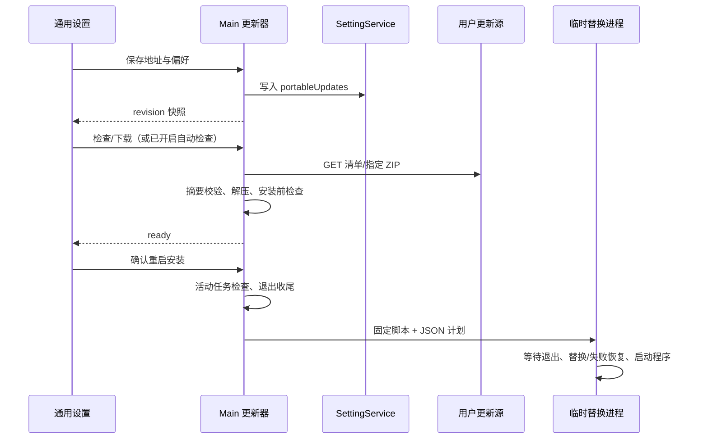

# 绿色版应用更新

## 规则与所有者

- 官方安装包更新器继续停用；绿色版更新由 Desktop Main 的 `portable-updates` 持有状态、请求、下载与安装任务。插件更新不变。
- 通用设置提供更新地址、自动检查、自动下载、立即检查、下载及重启安装。地址默认空、两项自动选项默认关闭；未填地址不联网，关闭自动检查只保留用户主动检查。自动下载不自动退出应用。
- 配置由现有 SettingService 写入 `portableUpdates`。关闭设置页不影响任务；所有窗口订阅 Main 的带 revision 快照。更换来源取消旧任务，迟到结果不得恢复旧来源候选包。
- 发现版本和下载就绪时提供全局轻提示，可打开通用设置；不会仅在设置页打开时才处理更新。
- 地址接受 GitHub 仓库/Release 页面、GitHub latest Release API 或自建 JSON；只支持 HTTP(S)。只请求填写的来源及其附件，不回退官方服务，不附带账号令牌、设备 ID、会话或配置内容，不携带浏览器 Cookie。
- GitHub 只读取稳定 Release，按系统/架构选 ZIP 并要求 SHA-256；提交来自 `target_commitish` 或 `build-info.json`。自建格式见下文。
- 同提交不是更新，较低基础版本不更新。同一基础版本的不同提交，仅在发布时间晚于本机构建时间时提供更新，支持 `3.18.2-mod.N`，避免重复提示当前修订或降级。
- 下载流式写入更新缓存，摘要通过后才解压到安装目录所在卷的临时目录；校验失败不触碰程序。重复操作去重，检查/下载可取消。
- 暂存阶段只记录本地阶段名，不记录清单地址、文件内容或凭据；用于区分归档检查、解压和身份验证失败。
- 安装须用户确认重启，运行中 Agent 会阻止安装。复用已有退出收尾；临时 helper 等待退出后替换，不启动常驻服务、不提权。
- Windows 复用 `.zcode-install-manifest` 确定程序所有的顶层条目，仅替换这些条目，保留旁边的自有文件。Mac 只替换当前 `.app`。数据目录与替换条目重叠或目录不可写时，在退出前报错。
- 替换失败恢复已移动的旧程序；成功后启动新程序并清除旧备份。失败记录下次启动展示。断电/强杀恢复不在本次保证范围。helper 使用固定脚本，计划经 JSON 或参数传入，路径不拼接为 shell 代码。
- Computer Use 随整包升级，没有独立升级入口。Linux 不显示此 Windows/Mac 安装能力。



## 自建清单

```json
{
  "version": "3.18.3-mod.1",
  "sourceCommit": "0123456789abcdef0123456789abcdef01234567",
  "publishedAt": "2026-11-15T00:00:00Z",
  "assets": {
    "win32-x64": {
      "url": "https://updates.example/ZCode-win-x64-portable.zip",
      "sha256": "64位十六进制摘要"
    },
    "darwin-arm64": {
      "url": "https://updates.example/ZCode-mac-arm64.zip",
      "sha256": "64位十六进制摘要"
    }
  }
}
```

## 验收

1. 默认、旧官方偏好及空地址均不产生请求；保存、重开设置与重启后偏好保持。
2. GitHub/自建源按架构选包；同提交和旧版本不提示，同基础版本的新修订可更新。
3. UI 展示检查、进度、就绪；操作去重，换源取消旧请求，多窗口拒绝迟到快照。
4. 摘要错误、无匹配 ZIP、网络失败有明确错误，程序目录保持原样。
5. Windows 临时目录验证实际替换、自有文件保留、故障恢复；Mac 原生验证 .app 替换、启动与恢复，不以静态检查代替。
6. 有运行中 Agent 时拒绝安装；安装前验证目录可写、数据目录边界及包身份。

UI 候选用例位于 settings/general/manual-review/pending；未执行的断言不标记已覆盖。
自动检查场景使用 `ZCODE_E2E_PACKAGED_APP_PATH` 指定正式绿色包。它只依赖公开 preload 更新接口，WDIO 就绪检查不要求正式包暴露开发专用 session store。
