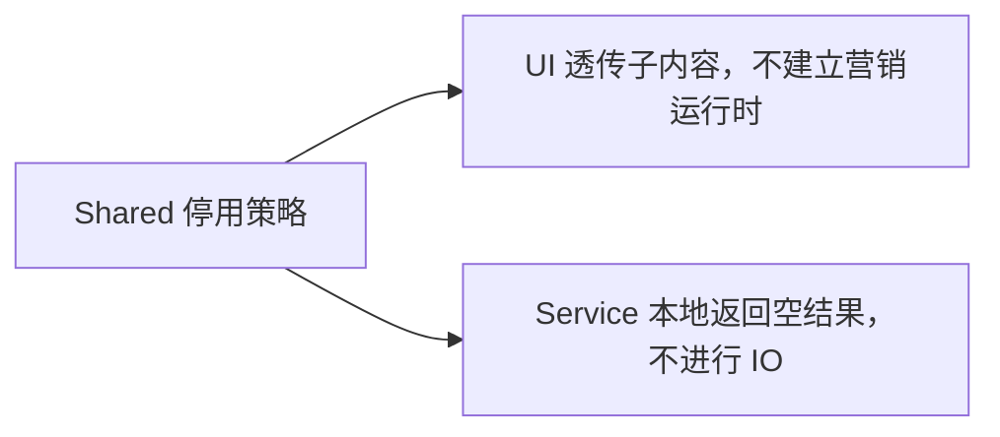

# 修改版关闭营销触达

- `@zcode/shared` 的 `ZCODE_MARKETING_TOUCH_ENABLED` 为唯一产品策略，固定为 `false`，不增加环境变量、系统设置或持久化状态。
- Desktop 与 Web 的营销 Provider 仅透传子内容，不建立 controller、轮询、事件监听或营销素材加载；活动 Banner、弹窗和任务完成刷新入口保持不可用。
- 服务契约保留：`query` 返回当前语言的空投放快照，`report` 直接完成。停用分支不读取账号凭据、设备标识，不调用 API 或素材授权回调。
- `/api/v1/marketing/touch` 与 `/api/v1/marketing/touch/action` 均不发送请求，包括旧调用者直接访问服务的情况。其他业务接口遵循原有规则。

验收场景：

1. 启动 Desktop/Web，切换窗口可见性、恢复联网、完成任务并经过原轮询周期，不查询、不上报、不加载营销资源，正常子界面仍可用。
2. 已登录和匿名调用者直接调用 query/report，均不读取身份、不访问 HTTP；空结果保留原服务返回结构。
3. 使用组件交互测试覆盖场景 1、服务测试覆盖场景 2；本次局部停用不运行浏览器截图回归。
